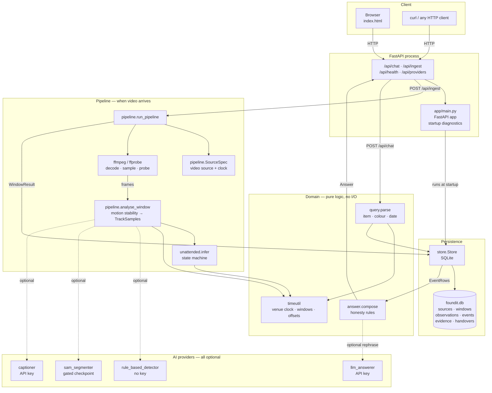
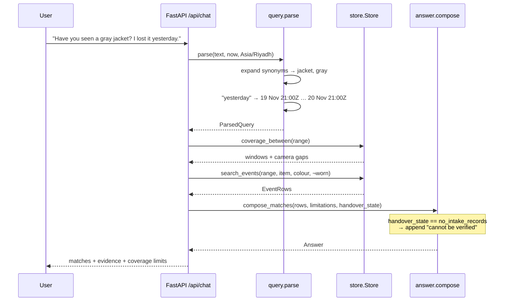
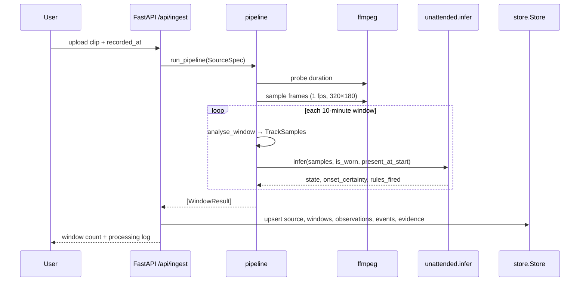
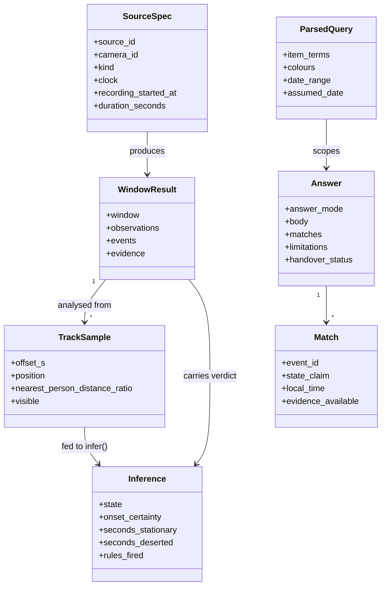
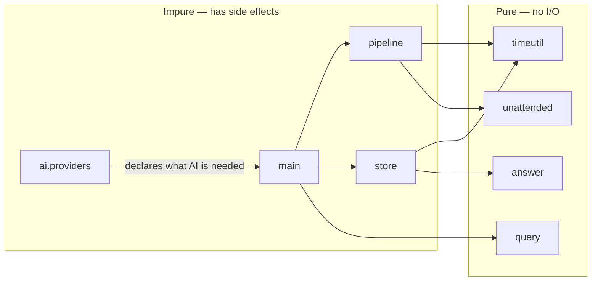

# Architecture

How the pieces connect, in two views: what runs when a video arrives, and what runs when a question arrives.

## Component diagram

A UML component diagram. Boxes are modules; arrows are "calls" or "reads/writes".

## Sequence — a question arrives

## Sequence — a video arrives

## Class relationships

## The three modules that must not import anything

`timeutil`, `query`, `answer` and `unattended` are pure: no network, no disk, no model. That is deliberate — they are the parts whose correctness the submission depends on, and purity is what makes them testable without mocking anything.

Everything that touches the outside world (ffmpeg, SQLite, API keys) lives in `pipeline`, `store`, and `main`.

## Where the boundary is

Swapping the motion detector for SAM means changing `pipeline.analyse_window` only. Nothing in `store`, `answer`, `query` or `timeutil` needs to know.
